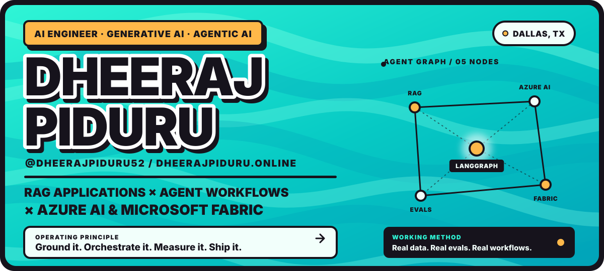

<p align="center">
  <a href="https://dheerajpiduru.online/">
    
  </a>
</p>

## ├──📂 Links

```bash
> Connect with me:
> portfolio  -> dheerajpiduru.online
> linkedin   -> /in/dheerajpiduru
> email      -> dheerajpiduru.9@gmail.com
```

<p>
  <a href="https://dheerajpiduru.online/"></a>
  <a href="https://www.linkedin.com/in/dheerajpiduru/"></a>
  <a href="mailto:dheerajpiduru.9@gmail.com"></a>
</p>

## ├──📂 About me

```yaml
name: Dheeraj Rahul Reddy Piduru
role: AI Engineer @ Community Dreams Foundation
previously: Data Engineer @ Accenture
location: Dallas, TX
education: M.S. Business Analytics & AI, UT Dallas
focus:
  - RAG applications with hybrid and semantic search
  - LangGraph agent workflows with tool calling and memory
  - Azure AI and Microsoft Fabric wired into real business workflows
certifications:
  - Google Cloud Professional Machine Learning Engineer
  - Microsoft AI-103 Azure AI Apps and Agents Developer Associate
```

<details open>
  <summary><h2>├──📂 Stack</h2></summary>

  <h3>🐍 Languages and Querying</h3>

  <p>
    
    
    
    
  </p>

  <h3>🧠 Generative AI and RAG</h3>

  <p>
    
    
    
    
    
    
    
    
  </p>

  <h3>🤖 Agentic AI</h3>

  <p>
    
    
    
    
    
    
  </p>

  <h3>📈 Evaluation and Monitoring</h3>

  <p>
    
    
    
    
  </p>

  <h3>🗄️ Microsoft Fabric and Data</h3>

  <p>
    
    
    
    
    
    
    
    
    
  </p>

  <h3>🧪 Machine Learning</h3>

  <p>
    
    
    
    
  </p>

  <h3>🛠️ Development and Integration</h3>

  <p>
    
    
    
    
    
    
    
    
    
  </p>
</details>

<details>
  <summary><h2>├──📂 Experience</h2></summary>

**AI Engineer, Community Dreams Foundation** *(Feb 2026 – Present)*
- Built a RAG application (LangGraph + OpenAI API + FAISS) indexing 50+ internal program documents, reaching ~85% grounded-response accuracy across 30 evaluation questions
- Developed LangGraph agentic workflows with 3 tool integrations, reducing manual handling by ~20%
- Integrated a SQLite-backed conversational assistant for program records, cutting lookup time from ~6 min to under 2 min
- Added Pydantic validation, Zapier automation, and conversation memory, reducing malformed tool/API responses by ~20%

**Data Engineer, Accenture** *(May 2021 – Oct 2023)*
- Built ingestion, transformation, and migration pipelines (Azure Data Factory, ADLS, PySpark, SQL) processing 1M+ records per run
- Implemented Medallion architecture (Bronze/Silver/Gold), reducing failed data-quality checks by ~25%
- Developed FastAPI REST APIs, cutting recurring manual data-extraction requests by ~35%
- Prototyped a RAG document Q&A solution (Azure OpenAI + Azure Cognitive Search), reaching ~80% relevant retrieval across 50 test questions

**Education**
- M.S. Business Analytics & Artificial Intelligence, University of Texas at Dallas *(Dec 2025)*
- B.Tech Computer Science & Engineering, Mahindra University, India *(Jun 2023)*
</details>

## └──📂 Activity


<p align="center">
  <em>Open to collaborating on Generative AI, agentic AI, and data engineering projects.</em>
  <br />
  
</p>
